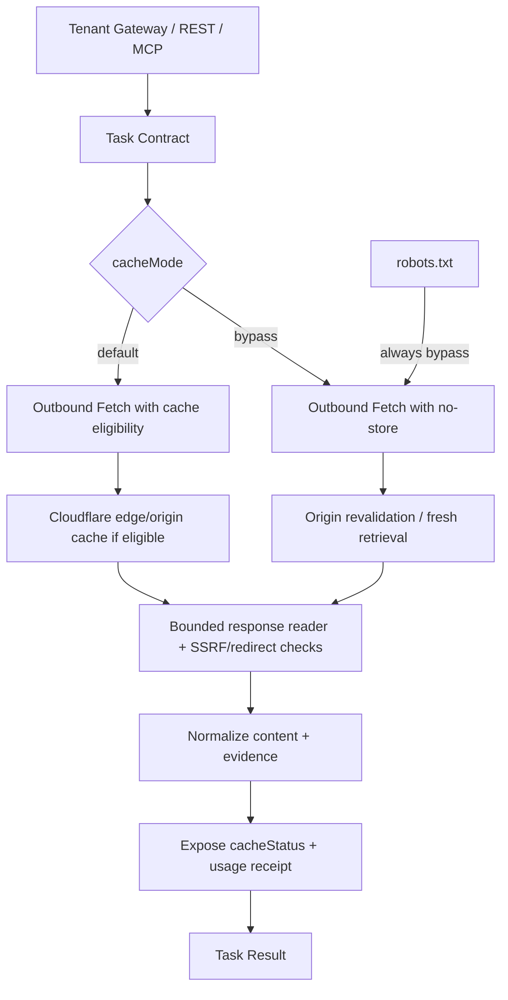

# ExportFlow Free-Tier Cache & Throughput Optimization

**Status:** Draft implementation plan + first Request-path cache integration  
**Branch:** `feat/request-first-cache-optimizer-20261124`  
**Base:** `70a73d01ed0bfe589de4848147975a9cc787d5eb`  
**Date:** 24 November 2026

## Executive decision

Treat caching as a first-class resource optimization, but do not confuse three different caches:

1. **Origin/edge cache for outbound Fetch subrequests** — this first implementation uses Cloudflare's normal Fetch cache behavior and honors explicit origin freshness/cacheability. It does not force `cacheEverything`, because arbitrary HTML/API responses without explicit public freshness metadata may be dynamic or personalized.
2. **Workers Cache in front of ExportFlow itself** — a separate product that can serve eligible GET/HEAD responses without invoking the Worker. It is not enabled yet because the platform exposes authenticated/account/session GET routes that must be audited and explicitly marked `private` or `no-store` first. A cache HIT still consumes one Worker Request; it saves Worker CPU, not the incoming request count.
3. **Persistent cross-request content cache (future R2 adapter)** — intended to reuse eligible public content even when the external origin is not cacheable through Cloudflare's edge. R2 is not enabled on the current account, so this is an architecture proposal only. No R2 bucket or binding was created.

**Important:** Caching does not create extra Cloudflare request quota. Outbound `fetch()` remains a subrequest inside the current Worker invocation, and POST `/api/v1/tasks` is not an eligible Workers Cache response. Edge caching may reduce origin load and latency for cache-eligible websites, but the Worker still needs to receive/process the response. Never describe this as increasing the 100,000 incoming Worker Requests/day quota.

## Current evidence snapshot

Read-only inspection of GitHub and Cloudflare on 23–24 November 2026 found:

- The current production Platform Worker has D1 and a shared Tenant Burst Limiter binding; no Queue or Workflow binding is present.
- The account's Queue and Workflow resource lists are empty.
- R2 API listing returned Cloudflare error 10042: R2 must first be enabled in the dashboard. No bucket is available to this application.
- Two existing KV namespaces are named `exportflow-company-snapshots-kv` and `exportflow-company-snapshots-prod-kv`. They belong to the company-snapshot feature and must not be repurposed as a generic content cache.
- The source Fetch path previously explicitly used `cache: "no-store"`, so it deliberately bypassed outbound cache.
- Public REST is still Fetch-only. Map/Crawl/Extract are internal adapters; Search/Research are not configured as live Production services.
- No Production configuration, R2, Queue, Workflow, binding, secret, or database was changed for this work.

## Cache pipeline

## Implemented in this branch

### Public Fetch primitive

- Adds an internal `cacheMode` with exactly two values:
  - `default` (default): uses `cache: "default"` and leaves cache eligibility to Cloudflare's normal rules and the origin response.
  - `bypass`: uses `cache: "no-store"` and does not set a `cf` cache override.
- Does **not** set `cacheTtl` or `cacheTtlByStatus`. This is deliberate: forcing a TTL could override a website's freshness intent.
- Reads the upstream `cf-cache-status` response header, normalizes it, and attaches the value to the response and usage receipt where available.
- Existing byte limits, response content-type checks, timeout, redirect revalidation, and SSRF/egress protections remain in the path.

### Task contract and adapters

- Adds the optional REST task field `cacheMode`; invalid values fail closed with `INVALID_CACHE_MODE`.
- Defaults to `default`; explicit `bypass` is available for freshness-sensitive work.
- Passes the selected mode through Fetch, Map, Crawl, and Extract adapters.
- Extract now returns the cache status in its result/evidence when available.
- Map/Crawl include cache status in page/source evidence where available.
- `robots.txt` is always fetched with `bypass`, so a stale cached robots policy is not used to authorize a crawl.
- Sitemaps and page bodies use the selected/default cache policy, subject to origin response headers and Cloudflare cache eligibility.

### What the first PR does not do

- It does not create a global content database or cross-region R2 cache.
- It does not enable Workers Cache in front of the whole Worker.
- It does not change any Production binding or Cloudflare account setting.
- It does not claim an actual edge cache HIT; current tests use mocked responses and inspect the outgoing Fetch options.

## Cache safety matrix

| Resource / response | Policy |
| --- | --- |
| Public HTML/text/JSON/XML with cacheable origin headers | Eligible in `default` mode; honor origin freshness |
| `Cache-Control: no-store` | Do not store |
| `Cache-Control: private` | Do not store in shared cache |
| `Set-Cookie` response | Cloudflare's normal bypass behavior; never strip it to force a cache hit |
| `Vary: *` | Do not cache |
| Authorization-bearing/private source | Do not cache or share across tenants |
| robots.txt | Always bypass for each Map/Crawl task |
| Search/provider responses | Cache only in a future provider adapter when its terms permit caching and freshness is known |
| Browser/session/page interaction | Never share-cache a user session or personalized browser result |
| Task response/result | Keep tenant-private; do not edge-cache the authenticated POST response |

### URL and key rules

- Preserve the entire query string because query parameters can change the page representation.
- Remove URL fragments only; fragments are not sent to HTTP origins.
- Do not strip UTM, tracking, locale, currency, or pagination parameters unless a source-specific contract proves they do not affect content.
- Include `Accept`/representation and parser/schema version in any future derived-extraction cache key.
- Never put authorization, cookies, API keys, private identifiers, or raw sensitive payloads into cache keys.

## Three cache layers and their cost profile

### 1) Outbound origin cache — first implementation

Use Worker `fetch()` with its normal cache behavior. Cloudflare caches standard static file extensions by default and also caches responses that explicitly opt in through origin headers such as `Cache-Control: public, max-age=...` or a future `Expires` date. HTML and JSON are not in the default cached extension list, so do not force them into a shared cache merely to improve hit rate.

- Do not set `cf.cacheEverything` for arbitrary public pages by default: with no origin freshness headers, Cloudflare's status-based default TTL may otherwise cache HTML/API responses that are dynamic or vary by geography.
- Responses with `private`, `no-store`, `Set-Cookie`, or `Vary: *` remain non-cacheable under the normal Free-plan origin-cache-control behavior.
- Does not remove the inbound Worker Request.
- Does not remove the Worker invocation.
- Does not remove the outbound Fetch subrequest from per-invocation subrequest accounting.
- Does not guarantee a HIT for arbitrary Internet origins; HTML/JSON without explicit public freshness headers and origins that do not expose cacheable assets will remain `DYNAMIC` or `BYPASS`.
- Can reduce requests that reach the origin, repeated download work on the origin side, and upstream latency when Cloudflare can cache that origin response.

### 2) Workers Cache in front of the ExportFlow Worker — future safe enablement

Cloudflare's Workers Cache is a separate cache layer controlled by `Cache-Control` on responses from ExportFlow itself.

Before enabling it:
1. Audit every GET/HEAD route, especially OAuth, account, tenant admin, workspace, API-key readiness and session routes.
2. Explicitly mark private/authenticated/session-specific responses `Cache-Control: private, no-store`.
3. Allow only intentionally public, deterministic GET responses (for example public capability/catalog metadata) to carry explicit `public, max-age=...`.
4. Confirm there is no per-tenant or session-specific response in a shared cache key.
5. Upgrade/verify Wrangler version at least 4.69.0 and test real Cloudflare cache statuses.

Free-tier economics:
- Every Workers Cache HIT still consumes a Worker Request.
- A HIT does not execute Worker code and therefore avoids Worker CPU for that request.
- This layer is useful for repeated public GET routes, not the authenticated POST task endpoint.

Do not set `cache.enabled = true` in the initial PR. It is a later, separately reviewed config change after the GET-route audit.

### 3) R2 persistent content cache — future opt-in

Cloudflare R2 is not enabled for this account. If the user later explicitly approves enabling R2 and adding a binding, use it as a durable content cache for popular public resources, not as a per-page D1 ledger.

Official R2 Free allowance currently documented:
- 10 GB-month Standard storage.
- 1 million Class A operations/month (writes/mutations).
- 10 million Class B operations/month (reads).
- Free egress.

Proposed safety budget (not provisioned):
- Reserve at least 30% of each monthly allowance.
- Cap initial cache writes around 600,000/month (about 20,000/day average) and reads around 7 million/month.
- Keep average object size small; evict/expire stale and low-value objects with lifecycle policy.
- Store raw response once; derived extraction results should have separate parser/schema-versioned keys only when reuse justifies the extra writes.
- Use conditional revalidation with ETag/Last-Modified where supported.
- Never cache `private`, `no-store`, session-bearing, credentialed, or disallowed content.

For a 40,000 Tool Calls/day workload, do not write every visited page to R2. A crawl-heavy workload could produce far more page units than parent Tool Calls. Use a bounded cache admission policy and resource meter; cache only likely-to-repeat public content. R2 read/write budgets must be metered separately from Worker Requests and D1 usage.

Existing KV namespaces are reserved for company snapshots. Do not repurpose them. KV's Free write quota is not suitable for a high-churn per-URL cache.

## Cache admission, freshness and cost controls

1. **Origin directives win.** Respect `Cache-Control`, ETag, Last-Modified, Set-Cookie, Vary and status semantics. No fixed TTL override in the first implementation.
2. **Cache only reusable public data.** Never share cache data across tenants when the response could vary by identity or authorization.
3. **Robots bypass.** Fetch the active robots policy for every Map/Crawl task before scheduling pages.
4. **Deduplicate inside a task.** Reuse already-fetched responses and deduplicate canonical URLs before scheduling another page unit.
5. **Bound concurrent fills.** Start with per-origin concurrency ≤2 for crawl work; lower it on 429/5xx or latency spikes. Avoid uncontrolled fan-out or stampedes.
6. **No blind retry.** Retry only transient failures with bounded backoff; do not retry policy denials, invalid URLs, permanent 4xx or robots denials.
7. **Partial results are explicit.** Cache misses, origin denials and budget exhaustion remain visible in the result; never silently use stale/private data.
8. **Do not write a D1 row per page.** Keep the customer quota reservation at one logical Tool Call; use the usage receipt and compact batch aggregation for platform measurement.

## Metrics and acceptance gates

Record and report separately:
- `cacheStatus`: HIT, MISS, EXPIRED, REVALIDATED, UPDATING, BYPASS, DYNAMIC or null when no status header exists.
- External fetch attempts, redirects, response bytes and origin status.
- Cache hit ratio by operation and origin class.
- Worker CPU p50/p95/p99 and duration, measured in the target runtime.
- D1 rows read/written, DO requests/writes, Queue operations, Workflow steps, R2 Class A/B operations and storage when those services are enabled.
- Successful page/task results, partial-result rate, 429 rate and retry rate.

Acceptance:
- Unit tests prove cache mode routing, explicit bypass, robots bypass, and cache status propagation.
- Wrangler dry-run proves Worker bundle compatibility.
- Real Cloudflare Preview acceptance must demonstrate a first MISS followed by a HIT/revalidation for a cache-eligible public origin, plus explicit `no-store` / `private` bypass behavior.
- Do not claim a cache savings percentage until the same corpus is run with cache bypass and default caching over multiple repeats in the actual Worker runtime.

## Cloudflare plan context and official documentation

- Workers pricing and request accounting: https://developers.cloudflare.com/workers/platform/pricing/
- Workers outbound cache behavior: https://developers.cloudflare.com/cache/interaction-cloudflare-products/workers/
- Workers Cache: https://developers.cloudflare.com/workers/cache/
- Workers Cache configuration: https://developers.cloudflare.com/workers/cache/configuration/
- Workers Cache limitations: https://developers.cloudflare.com/workers/cache/limitations/
- Cache-Control: https://developers.cloudflare.com/cache/concepts/cache-control/
- Cache revalidation: https://developers.cloudflare.com/cache/concepts/revalidation/
- R2 pricing: https://developers.cloudflare.com/r2/pricing/

## Change boundary

This plan and its initial source/test changes are isolated to the approved GitHub feature branch. No Production Worker code was deployed; no R2/Queue/Workflow/Analytics resource was created; no binding, secret, DNS, permission, or paid feature was changed. Cloudflare Cache behavior has not yet been verified against the actual target runtime.
